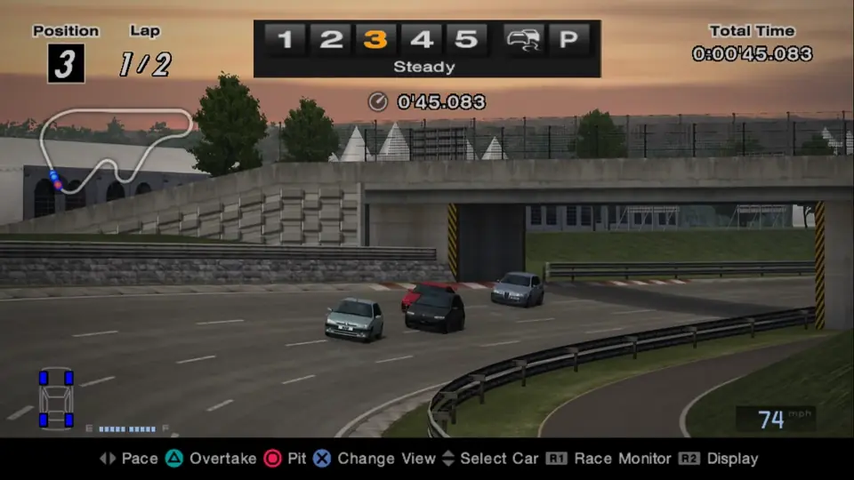
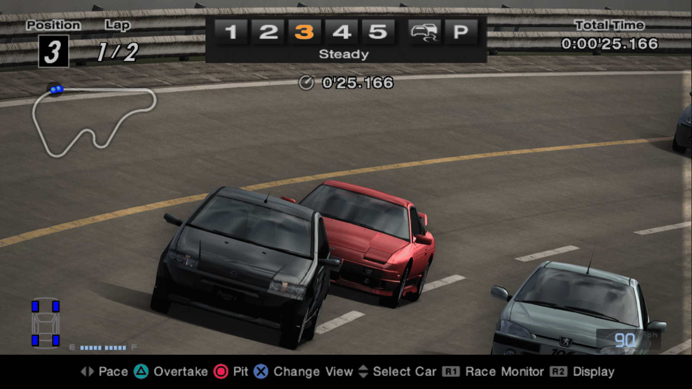
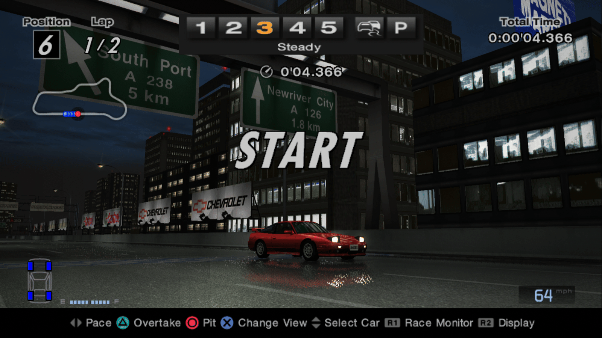
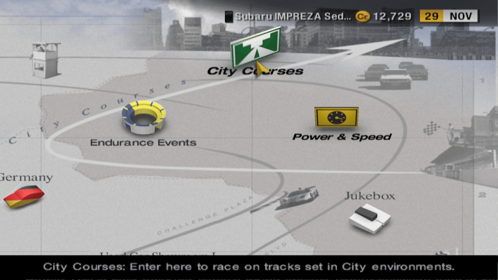
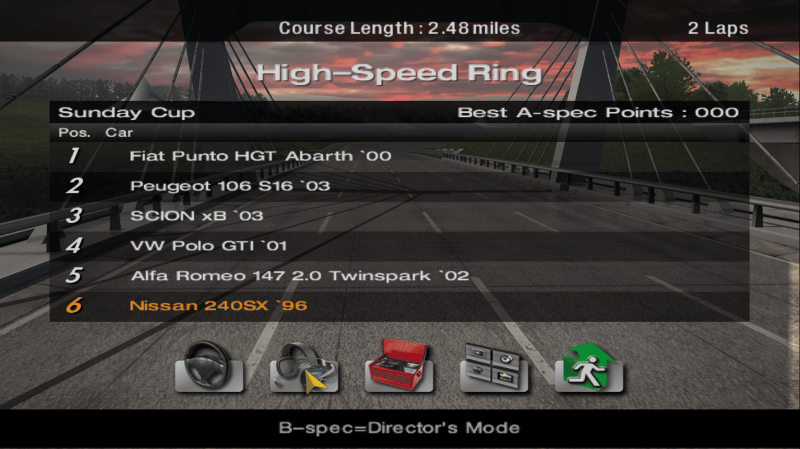
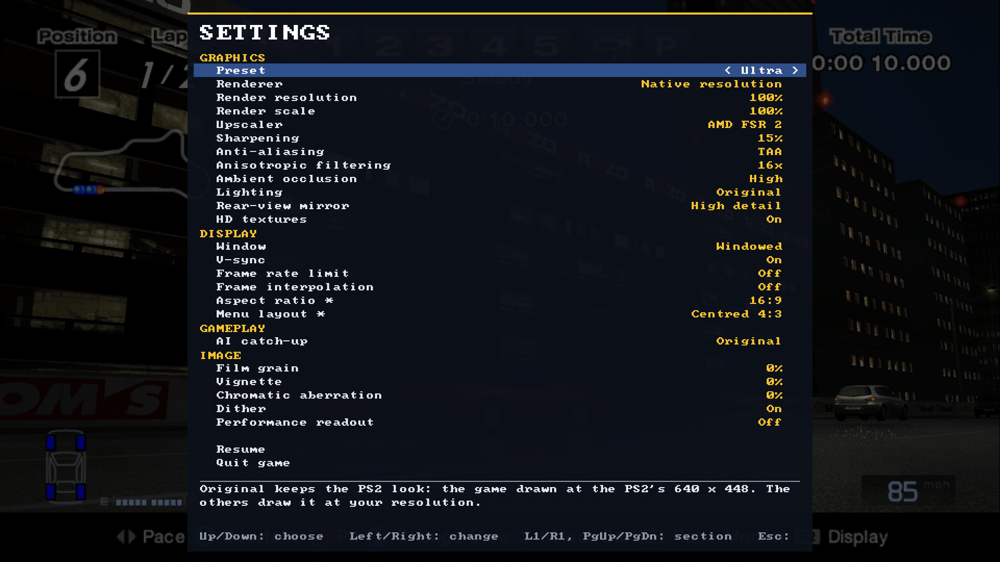

# GT4 Native

**Gran Turismo 4 running as a native PC program, from your own copy of the game.** The game's code comes from the
[gt4-decomp](https://github.com/gustavocanepa/gt4-decomp) decompilation, compiled for the PC, with a Vulkan renderer,
native sound, native saves and settings pages of its own. There is no PS2 emulator in it.

It runs on Windows, and on Linux through Proton: Steam Deck, or an ARM handheld such as the AYN Odin 3 (Proton with
FEX).

> **Version 0.1.0, early.** The game boots, the menus, GT mode and races work, and saves load and save. Expect bugs:
> see [Known issues](#known-issues). Nothing from the game is included: you need your own disc.



Maintained by [Julien Ganichot](https://github.com/Ganitzsh). Based on Gustavo Canepa's
[gt4-native](https://github.com/gustavocanepa/gt4-native) and [gt4-decomp](https://github.com/gustavocanepa/gt4-decomp):
see [Credits](#credits).

## Screenshots

Captured at 1920x1080 on the Ultra preset. A 44-second race video (1080p60, with sound) is attached to the
[0.1.0 release](https://github.com/Ganitzsh/gt4-native/releases/tag/v0.1.0).

| | |
|---|---|
|  |  |
|  |  |
|  |  |

## What you need

- **Gran Turismo 4, NTSC-U (USA), version 1.01**, serial SCUS-97328, dumped from your own disc to an `.iso`
  ([Redump](http://redump.org/disc/955) CRC32 `d1d25931`). The port places the game's code at that release's
  addresses, so other regions (PAL, Japan) and versions cannot work. It tells you if your image is a different one.
- **Windows 10 or 11, 64-bit**, or **Linux with Steam and Proton**.
- **A GPU with a Vulkan 1.3 driver** (with dynamic rendering, synchronization2 and push descriptors: any current AMD,
  NVIDIA or Intel driver). `gt4_host.exe --list-gpus` tells you whether yours qualifies.
- A gamepad (Xbox or PlayStation layout, Steam Deck controls), or a keyboard.

Nothing to install: the Visual C++ runtime comes in the folder.

## Install

1. Download `GT4-Native-<version>-windows-x64.zip` from [Releases](https://github.com/Ganitzsh/gt4-native/releases) and
   extract it anywhere. You get a `GT4-Native-<version>` folder with `gt4_host.exe`, `gt4_game.exe`, an empty
   `game/` and an empty `saves/`.
2. Put your disc image in `game/`, for example `game/Gran Turismo 4 (USA) (v1.01).iso`.
3. Start `gt4_host.exe`. On the first start it reads the game's executable from the disc image, checks it is the
   USA 1.01 release, and writes `game/CORE.GT4.elf` beside it (about a second). With no image, or another release,
   a message says what to do.

The host finds the game, `settings.ini` and `saves/` beside itself, and writes `game.log` and `host.log` there. The
folder can be copied anywhere: another PC, an SD card, a handheld.

## Controls

| PS2 pad | Gamepad | Keyboard |
|---|---|---|
| Directional buttons | D-pad | Arrow keys |
| Cross / Circle / Square / Triangle | South / East / West / North | X / C / Z / V |
| L1 / R1 | Shoulder buttons | Q / E |
| L2 / R2 (analogue) | Triggers | 1 / 3 |
| L3 / R3 | Stick clicks | |
| Left stick | Left stick | I / J / K / L |
| Right stick | Right stick | |
| Start / Select | Start / Back | Enter / Backspace or Right Shift |
| Settings | Guide, or Select + Start | Escape |
| Problem dump (below) | L3 + R3 pressed and held together (pad 1 in a game) | Ctrl + F12 |
| Fullscreen | | F11 or Alt+Enter |

### Linux, Steam Deck and ARM handhelds

The same Windows executables run under Proton:

1. Extract the zip on the device and put your disc image in `game/`.
2. On a handheld, replace `settings.ini` with `settings-handheld.ini` (rename it to `settings.ini`) before the first
   start: the low preset, borderless, 16:9, and no frame interpolation, so it runs at the game's 60 frames a second.
3. Steam (desktop mode) > Games > Add a Non-Steam Game > Browse: `gt4_host.exe`.
4. The new entry's Properties > Compatibility: force Proton Experimental, or the newest Proton listed.
5. Start it from game mode.

The host is a 64-bit and the game a 32-bit Windows program; on an ARM handheld, Proton runs both through FEX.

## Settings

Press **Escape** on the keyboard, or the pad's **Guide** button (or **Select + Start**), to open Settings. Over a
running game, the game opens them at its next menu screen; in a race, the same keys pause it and open them
from the pause screen (Start alone pauses as GT4 does). The same keys close them. With no game, the host shows them
itself; quit with the **Quit** row on the System tab, or Alt+F4.

Under the `low` to `ultra` presets, GT4's own Options items and Start on the GT mode map open Settings too, and the
race pause is this game's pause page (Continue, Retry, Exit, Screen, Settings). The `original` preset keeps GT4's
screens and pause as on the PS2. Both are settings of their own: Settings entry and Race pause, on the
Accessibility tab.

| Action | Pad | Keyboard |
|---|---|---|
| Choose an option | D-pad up/down | Arrow keys |
| Change its value | D-pad left/right | Arrow keys |
| Switch tabs | L1 / R1 | Q / E |
| Accept | Cross | X |
| Back | Circle | C |

Changes are saved to `settings.ini`. Most apply at once; a row that applies after a confirmation, at the next
race or at the next start says so. Each option shows a description. The main ones:

- **Graphics**: the preset (`original`, `low`, `medium`, `high`, `ultra`), PS2 or native resolution, render scale,
  upscaler (FSR 1, FSR 2), sharpening, anti-aliasing, texture filtering, lighting, rear-view mirror detail,
  HD textures, shadows, reflections, bloom, depth of field, motion blur, tone mapping.
- **Display**: window or fullscreen, v-sync, **Frame rate limit**, **Frame interpolation**, aspect ratio, menu and
  HUD layout.
- **Game**: the AI's catch-up. Every other option leaves the game itself as it was.
- **Image**: film grain, vignette, chromatic aberration, dither, and a performance readout (frame rate on screen).

The `original` preset shows the game as the PS2 drew it, at its resolution. Every option and its values are listed
in [docs/RENDERING.md](docs/RENDERING.md#settings-reference), and `gt4_host.exe --list-options` prints them.

**Frame rate and battery.** The game runs at 60 frames a second. With Frame interpolation on, the host draws extra
frames between the game's to match a faster screen (120 Hz, 144 Hz): smoother, but about twice the GPU work. On a
handheld or on battery, turn it off and leave Frame rate limit at 0: the host then shows each game frame once,
60 a second.

## Importing your saves

The game keeps its saves as plain folders in `saves/`, one per save (`BASCUS-97328GAMEDATA` holds the career and the
garage). They are the game's own files, so they move between this port, a PS2 and PCSX2 unchanged.

To bring a save from PCSX2, NetherSX2, AetherSX2 or a PS2 memory card dump, run once from the GT4-Native folder:

```sh
gt4_host.exe --import-save "path/to/Mcd001.ps2"
```

The saves go into the folder's `saves/`.

`PATH` can be:
- a memory card image: PCSX2's `.ps2`, or a raw dump (`.bin`, `.mcd`);
- a PCSX2 folder memory card;
- a single save exported as `.psu` (uLaunchELF, PCSX2's memory card editor).

Only GT4 USA saves (`BASCUS-97328...`) are copied; other games' saves are left alone. A save already in `saves/` with
the same name is kept beside the new one, renamed `NAME.before-import-<date>`.

On Linux, run the import on a Windows PC, or copy the save folders by hand: a PCSX2 folder memory card already holds
them as folders (`BASCUS-97328GAMEDATA`), so copy those into `saves/`. To back your progress up, copy `saves/`.

## Taking your saves to PCSX2 or a PS2

```sh
gt4_host.exe --export-save "path/to/GT4.psu"
```

writes one save as a `.psu` (by default `BASCUS-97328GAMEDATA`, the career and garage; another with
`--export-name NAME`). PCSX2's memory card editor and uLaunchELF on a PS2 import it onto a card. This is the safe
way: your cards are only changed by PCSX2 or the PS2 themselves.

```sh
gt4_host.exe --export-save "path/to/GT4.ps2"
```

writes a new 8 MB memory card image holding every Gran Turismo 4 save in `saves/`. In PCSX2, put it in the memory
card folder and choose it for slot 1 (Settings > Memory Cards); GT4 then finds the save as it would on a PS2.

Both only ever write a new file. An existing file is refused, and never opened: to replace it, add `--force`, and the
new file is written beside it and renamed over it. Point `--export-save` at a new name, never at a card you use.

Copying a save folder from `saves/` into a PCSX2 *folder* memory card does not work: GT4 finds no data there. A folder
card also needs the files PCSX2 writes when it formats one or saves into it (`_pcsx2_superblock` and per-folder
metadata), which a plain copy lacks. Use `--export-save` instead. More detail: [docs/SAVES.md](docs/SAVES.md).

## HD texture packs

The port can draw a texture pack's high-resolution images in place of the game's textures. It reads the packs
made for PCSX2's texture replacement (PNG files for the USA release, SCUS-97328), so a pack installed for PCSX2
works as it is. Known packs: the **GT4 Retexture Mod** by Hattersby and team (GTPlanet thread "Gran Turismo 4
Retexture Mod": tracks, cars, menus and HUD) and the **HD HUD & UI** pack by Silentwarior112. They are not part of
this project: get them from their authors.

To install one, put the pack's folder in `textures/SCUS-97328` inside the GT4-Native folder:

```
GT4-Native-0.1.0/
  gt4_host.exe
  textures/SCUS-97328/   <- the pack's PNG files, in any subfolders
```

A pack that comes in versions (for example 3.0, then 3.0.1 to 3.0.4) is installed in order, each one's files over
the last. If PCSX2 is installed on the same PC with a pack, the port finds PCSX2's `textures/SCUS-97328` too.

Switch it on and off with **HD textures** in Settings (Graphics). It reads "Not installed" when no pack was
found at start. Textures load in the background the first time they're drawn, so the original shows for a few
frames first. Other places the port looks, and how matching works: [docs/TEXTURE_PACKS.md](docs/TEXTURE_PACKS.md).

## Known issues

- Car reflections show on the road in dry weather.
- Car wheels are sometimes drawn transparent, and the car pictures on the results screen have missing pixels.
- Frame drops with far cameras: rolling starts, replays, and looking back.
- The speedometer's scale and needle can be blank (the digital speed shows). Fixed on main for the next release.
- After a race, some text can show wrong letters (an `E` drawn as `ä`), and car names can be missing on a results
  screen.
- Magenta specks in car reflections, and car paint looks wrong in replays.
- Trading cars needs a second memory card and is not available.

Report problems on the [issue tracker](https://github.com/Ganitzsh/gt4-native/issues) with `game.log` and `host.log`
from the GT4-Native folder.

To show what the screen looks like when something goes wrong, press **L3 + R3** together (both sticks clicked, on pad
1 in a game) and hold them for a quarter second, or press **Ctrl + F12**: the host writes `dumps/<date-time>/` in its
folder with that frame and the next as PNG, the frame's drawing commands (`draws.txt`), the graphics memory
(`gs_memory.bin`), your settings and the display's details (`info.txt`). A one-line message on screen confirms it. The
frames and the memory are pictures from your own game: keep them to yourself, or share only the folder with whoever is
fixing the problem.

## Versions

Releases follow [semantic versioning](https://semver.org) and are tagged `vMAJOR.MINOR.PATCH` (first: `v0.1.0`).
What changed in each: [CHANGELOG.md](CHANGELOG.md). Each release has a `BUILD-INFO.txt` with the commits it was built
from and the programs' SHA-256, and a `game-sources` zip with the exact gt4-decomp sources `gt4_game.exe` was
compiled from.

## Building from source

Requires CMake 3.21+, a C++20 compiler and the Vulkan SDK. The game executable (`gt4_game.exe`) also needs a
gt4-decomp checkout and its toolchain: see [docs/NATIVE_GAME.md](docs/NATIVE_GAME.md) and
[docs/GAME_TOOLCHAIN.md](docs/GAME_TOOLCHAIN.md).

```sh
cmake -S . -B build -DBUILD_TESTING=ON
cmake --build build
ctest --test-dir build --output-on-failure
```

How the port works: [docs/ARCHITECTURE.md](docs/ARCHITECTURE.md), [docs/NATIVE_GAME.md](docs/NATIVE_GAME.md),
[docs/RENDERING.md](docs/RENDERING.md), [docs/PLATFORM.md](docs/PLATFORM.md). Fixes to the decompiled game code
belong upstream in [gt4-decomp](https://github.com/gustavocanepa/gt4-decomp); changes to the port go here.

## Credits

- **[Gustavo Canepa](https://github.com/gustavocanepa)** started [gt4-decomp](https://github.com/gustavocanepa/gt4-decomp),
  the matching decompilation of Gran Turismo 4 this port is built on, and the original
  [gt4-native](https://github.com/gustavocanepa/gt4-native), which this repository is a fork of.
- The [gt4-decomp contributors](https://github.com/gustavocanepa/gt4-decomp/graphs/contributors) and the Gran
  Turismo modding and reverse-engineering community.
- **[Julien Ganichot](https://github.com/Ganitzsh)**: this fork's playable build (the native game runtime, renderer,
  sound, saves, settings pages, packaging and Proton support).
- Third-party libraries (SDL3, FSR, glslang and others): [THIRD_PARTY_NOTICES.md](THIRD_PARTY_NOTICES.md).

More in [CREDITS.md](CREDITS.md).

## Legal

Independent, unofficial project, not affiliated with or endorsed by Sony Interactive Entertainment or Polyphony
Digital. Gran Turismo is a trademark of Sony Interactive Entertainment. No game data, disc image, original executable,
BIOS or proprietary SDK file is distributed here or in the releases: you need your own legally obtained copy of the
game.

This repository's code is licensed under the [GNU General Public License, version 3](LICENSE) (GPL-3.0).
Copyright (c) 2026 Gustavo Canepa; changes in this fork copyright (c) 2026 Julien Ganichot. Anyone who distributes
this port or a work based on it must make the corresponding source available under the same license.

Sources from [gt4-decomp](https://github.com/gustavocanepa/gt4-decomp) keep their own MIT license and notices; MIT
code may be combined with GPL code. Revisions up to and including commit `5799594b1fa25218f1d1c0b87602036d508aaf53`
were published under the MIT license and remain available under it. See
[THIRD_PARTY_NOTICES.md](THIRD_PARTY_NOTICES.md) and [docs/RELEASE_POLICY.md](docs/RELEASE_POLICY.md).
