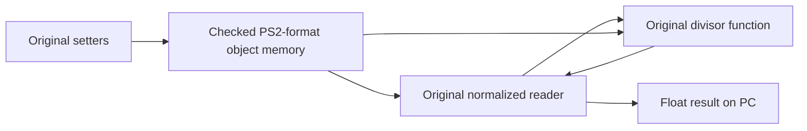

# Milestone 4 — original accessor chain over PS2-format memory

## Scope and pinned source

The bulk import is pinned to GT4 Decomp commit
`ba5ebe778a786d92b108926b8f89843ea1a9b5cf`, including the completed RTTI block.
The inventory contains 28,443 translation units and 28,997 source/header files.
Importing the RTTI sources does not integrate their old C++ ABI into the PC runtime.

Fifteen original source functions are selected in `upstream/gt4/integration.json`.
Thirteen accessor/calculation bodies form the new production runtime slice:

| Original address | Access |
|---|---|
| 001465D8 | Convert signed field 0x178 to float and divide by 100 |
| 005C9930 | Write signed field 0x174 |
| 005C9938 | Write signed field 0x178 |
| 005C9940 | Write signed field 0x17C |
| 005C9948 | Write signed field 0x180 |
| 005C9950 | Write signed field 0x188 |
| 005C9958 | Read signed field 0x174 |
| 005C9960 | Read signed field 0x178 |
| 005C9968 | Read signed field 0x184 |
| 005C9970 | Divide signed field 0x174 by the original 001465D8 result |
| 005C99A8 | Read signed field 0x17C |
| 005C99B0 | Read signed field 0x180 |
| 005C99B8 | Read signed field 0x188 |

The upstream `hArrayCompare` directory is a source-layout bucket. It does not
prove the object's class name or the gameplay meaning of these fields.
The minimum supported wire extent is 0x18C bytes, aligned to four bytes.
This is not a recovered complete game class.

## Resolving the caller ABI

The PS2 call site was inspected in the user's own original executable with
`tools/match.py asm 005C9970` and `tools/match.py asm 001465D8` in GT4 Decomp.
No binary or disassembly dump is distributed here.

At 0x005C997C, the normalized reader calls 0x001465D8 without changing argument
register a0. Its delay slot preserves that same object address in s0. The callee
reads signed field 0x178 from a0; after the call the reader loads signed field
0x174 from the object preserved in s0 and divides by the returned float in f0.
Both fields therefore belong to the same incoming object for this call.

The original C declaration has an unspecified argument list and no explicit
argument at the call site. Relying on residual registers is not a valid portable
host implementation. The native adaptation explicitly passes `arg0` to
`func_001465D8`. The previous global divisor fixture and renamed-calculation
wrapper are removed. No process-global object supplies the missing argument.

## How the original bodies access guest memory

Original imported files remain byte-identical to their pinned source after the
two-line provenance prefix. `tools/adapt_object_fields.py` verifies hashes and
reproduces the reviewed adaptation in `compat/abi/object_fields_functions.inc`.
It replaces host-facing parameter declarations with an explicit `View*`.
Twelve bodies are preserved verbatim. The thirteenth changes only the explicit
same-object argument explained above. Source and body hashes record that change.

The view's scalar field proxies load/store through `AddressSpace`; they never
reinterpret a guest address as a host pointer or cache the whole object in an
unrelated host structure. The original normalized reader directly calls the
original divisor body, with both operating on the same guest-backed view.



All thirteen addresses can be registered in `NativeCallbacks`. Integer arguments
and results use their 32-bit representation; float results use IEEE-754 bits in
the registry's uint32 slot. Native void adapters return zero in that slot. This is a documented native callback ABI, not an
implementation of arbitrary PS2 register calls, vtables, or unported MIPS code.

## Typed guest objects, pointers and arrays

- `guest_ptr` remains four bytes on the host. Scalar reads/writes support fixed
  width integers and IEEE float/double, preserving their little-endian bits.
- Structured pointers use explicit wire size/alignment descriptors, not host
  `sizeof` or C++ object layouts. `field<T>` checks the declared object extent;
  const object fields retain const qualification.
- `load_pointer`/`store_pointer` encode embedded pointers as four-byte addresses.
- `guest_span` validates its declared extent and every array index. Actual access
  still checks mapping boundaries, alignment and write permission.
- Invalid/null addresses, arithmetic overflow, truncated mappings, and read-only
  writes fail explicitly. This layer does not implement MMIO, DMA or VU memory.

## Executable demonstration and validation

```sh
python3 tools/adapt_object_fields.py --check
python3 -m unittest discover -s tests -p 'test_*.py' -v
cmake -S . -B build -DBUILD_TESTING=ON -DGT4_STRICT_WARNINGS=ON
cmake --build build --parallel 2
ctest --test-dir build --output-on-failure
./build/gt4_native --object-demo
```

The production executable runs the original setter/reader/calculation chain
through the callback registry and prints a normalized result of 30 for fields
120 and 400. Its existing `--self-test` now exercises that chain as well.
It also builds with `BUILD_TESTING=OFF`; the runtime slice is not test-only code.

Regression coverage includes all thirteen functions, two independent objects
with interleaved calls, 10,000 finite arithmetic cases, read-only input, invalid
and truncated objects, embedded pointers, float bit patterns and array boundaries.
The generated adaptation is reproduced and checked in CI. Windows Release CI
publishes the `gt4-native-windows-object-demo` executable artifact.

Local validation on this implementation:

| Configuration | Result |
|---|---|
| GCC Debug, strict warnings | 16/16 CTest targets passed |
| Clang Debug, strict warnings | 16/16 passed |
| GCC Release, strict warnings | 16/16 passed; assertions retained |
| Clang ASan + UBSan, leak detection enabled | 16/16 passed |
| Production Release, BUILD_TESTING=OFF | Build and object demonstration passed |
| Python tools and provenance regression checks | 19/19 passed |
| Pinned import syntax probes / isolated links | 30/30 and 20/20 passed |

These are host integration checks plus call-site inspection. They are not a
PS2 execution trace, a complete old GCC ABI implementation, or a playable game.
IEEE NaN/infinity/denormal and exceptional PS2 FPU behavior are not emulated.
No original game assets are needed by the demonstration or CI.
